# EnlacesPanel

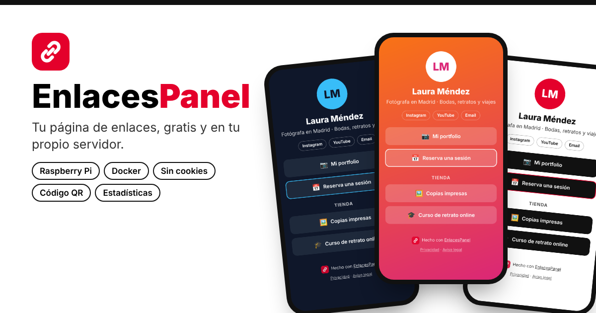

Tu página de enlaces ("link in bio") en tu propio servidor, **gratis y sin cuotas**. Una sola
dirección para poner en Instagram, TikTok o tu tarjeta de visita, con todos tus enlaces dentro.
Pensado para una Raspberry Pi 3, 4 o 5 (funciona en cualquier Linux con Docker). Muy ligero
(unos 50 MB de RAM), en español, con modo claro/oscuro y **sin cookies ni rastreadores** para
quien visita tu página.

> **Idiomas / Languages:** ahora EnlacesPanel está en español. El inglés llegará pronto.
> EnlacesPanel is in Spanish right now. English is coming soon.

**Qué incluye:**

- **Tu página pública** en `http://tu-servidor/tu-nombre`, con foto, nombre, bio, redes
  sociales y tus enlaces. Se genera en el servidor: carga al instante incluso en móviles viejos.
- **Editor con vista previa en directo**: elige **Móvil, Tablet o PC** en la cabecera y la vista
  previa cambia de tamaño mientras editas. El botón **Ver mi página** la abre a pantalla completa.
- **Tu dominio:** pon la dirección pública del servidor (`https://enlaces.midominio.com/laura`)
  o un **dominio propio para cada página** (`https://laura.com`). El enlace, el botón Compartir
  y el QR usan tu dominio.
- **Enlaces** con **foto o logo** (o un emoji) a la izquierda del botón, **títulos de sección**, ordenar arrastrando (o con ↑ ↓), ocultar sin
  borrar, **destacar** uno para que llame la atención y **programarlos** con un interruptor (que
  aparezcan o caduquen solos en una fecha, perfecto para ofertas o eventos; apagado, no caducan).
- **Redes con iconos** al final de la página (o debajo de la bio): WhatsApp, Telegram, correo,
  teléfono, Instagram, TikTok, YouTube… Solo escribes tu número, @usuario o email y al tocarlos se
  abre la app directamente.
- **Diseño animado:** 10 temas (Noche, Papel, Bosque, Atardecer, Arena, Mar, Lavanda, Aurora,
  Neón y Carbón), un tema **Propio** con tus colores, 4 estilos de botón y animación **Suave**,
  **Viva** o ninguna: los botones entran uno a uno, brillan al pasar el ratón y se hunden al
  pulsarlos, y los fondos con degradado se mueven despacio. Todo con CSS, sin JavaScript.
- **Estadísticas sin cookies:** visitas y clics por día y por enlace, de 7 días a 1 año.
- **Código QR** de tu página, con tus colores, para descargar en PNG o SVG e imprimir.
- **Varias páginas por usuario** (personal, negocio…) y **varios usuarios**: el administrador
  los crea desde el panel (con contraseña generada si quiere) o aprueba los que se registran.
- **Novedades a la vista:** tras actualizar, el panel (en el navegador y en la app) enseña una
  vez qué ha cambiado. La versión de la web y de la app sale en Cuenta → Acerca de, y la lista
  completa está en [`app/NOVEDADES.md`](app/NOVEDADES.md).
- **Aviso legal** propio en cada página y **política de privacidad** ya hecha (RGPD).
- **Tus datos son tuyos:** descárgalos en un archivo o borra tu cuenta cuando quieras.
- **App para Android** que se conecta a tu servidor por tu dominio o por la wifi de casa, y en
  iPhone se puede añadir a la pantalla de inicio.

Hecho con Python (FastAPI + SQLite) y JavaScript sin frameworks.

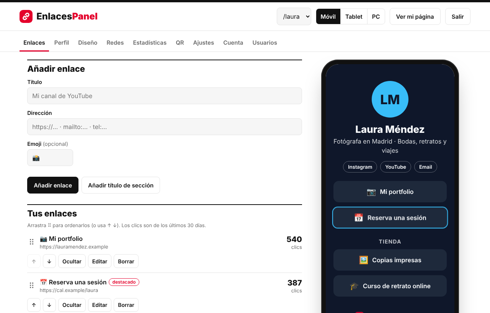

<details>
<summary><b>Más capturas</b></summary>

| | |
|---|---|
| 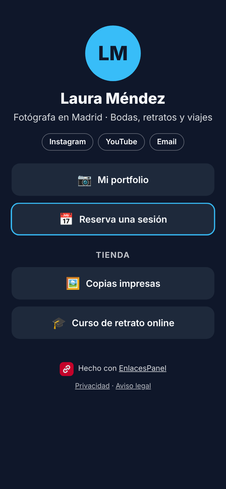 | 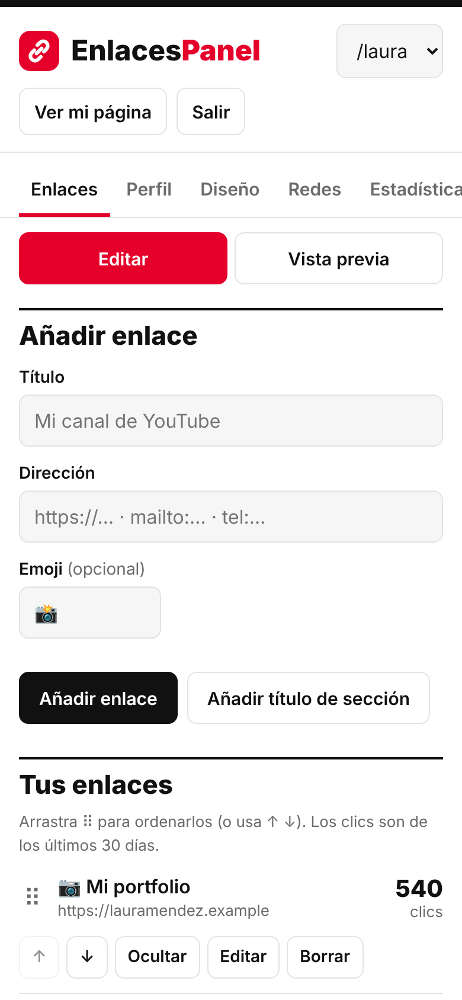 |
| **Tu página** en el móvil | **El editor** en el móvil |
| 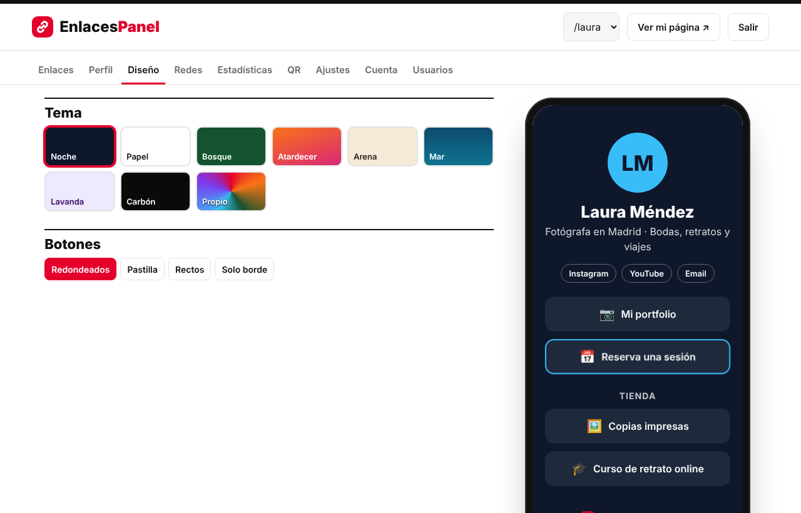 | 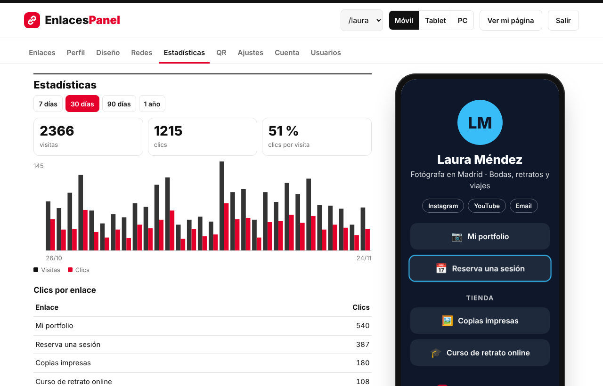 |
| **Diseño**: temas y botones | **Estadísticas** sin cookies |
| 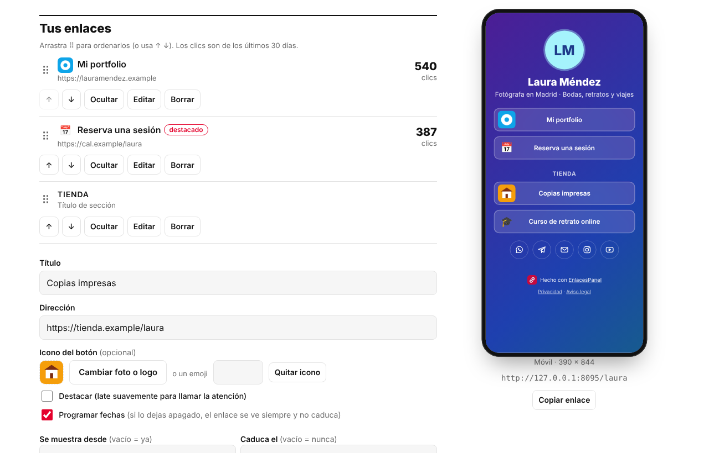 | 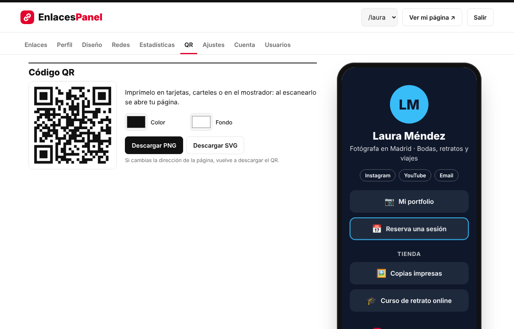 |
| **Editar un enlace**: destacar y programar | **Código QR** para imprimir |
| 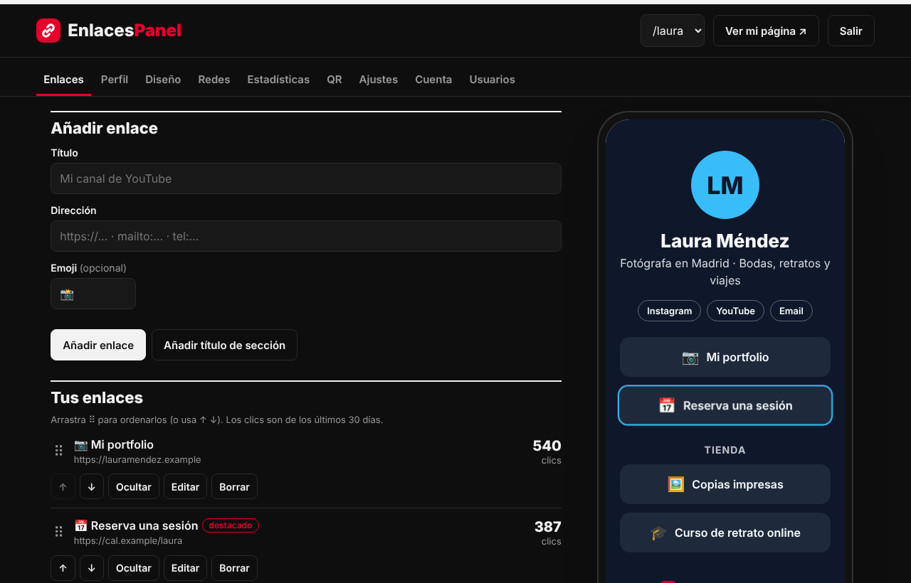 | 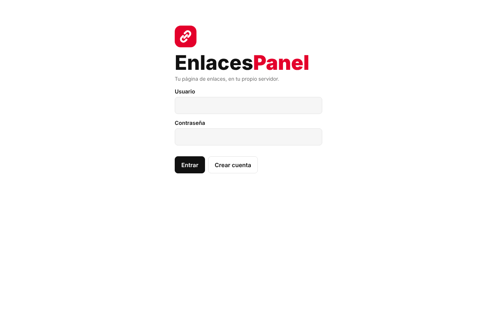 |
| **Modo oscuro** | **Pantalla de entrada** |
| 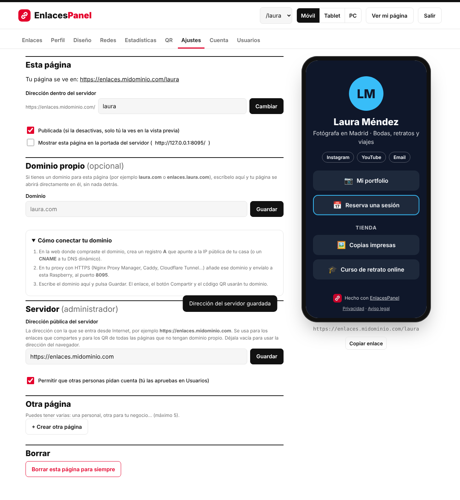 | 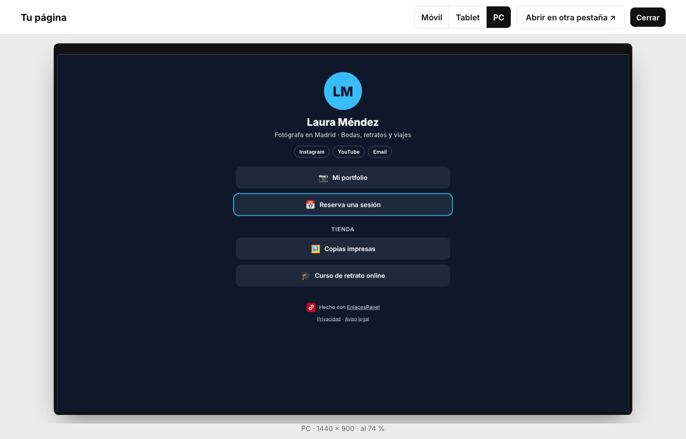 |
| **Ajustes**: dirección y dominio propio | **Ver mi página** en móvil, tablet o PC |

</details>

---

## 1. Requisitos

- Una Raspberry Pi 3, 4 o 5 (o cualquier PC o servidor con Linux).
- Docker con el plugin Compose. Si no lo tienes: `curl -fsSL https://get.docker.com | sh`
- Unos 250 MB de espacio. Los datos ocupan muy poco (casi todo son las fotos de perfil).

Funciona en Raspberry Pi OS de 32 y de 64 bits: todas las piezas son Python puro, así que
no hay que compilar nada.

## 2. Instalar

```bash
git clone https://github.com/pctecnikk/enlacespanel.git
cd enlacespanel
./install.sh          # crea la configuración (.env), construye y arranca
```

Se instala todo de una vez, sin preguntar nada. Si quieres cambiar dónde se guardan los datos
o el puerto, edita después el archivo `.env` (`nano .env`) y vuelve a ejecutar `./install.sh`.

Al terminar te dice la dirección: `http://IP-DE-TU-PI:8092/panel`

### Primer acceso

- Si pusiste `ADMIN_USER` y `ADMIN_PASSWORD` en `.env`, entra con ellos.
- Si no, **la primera cuenta que crees será la del administrador**.
- Entras directamente al editor: tu página ya está creada con tu usuario (por ejemplo
  `/david`). La dirección, el dominio y lo demás se cambian cuando quieras en **Ajustes**.
- En **Ajustes** puedes marcar tu página como **portada del servidor**: así se abre al entrar en
  `http://tu-servidor/` a secas.

## 3. Configuración (`.env`)

| Variable | Para qué sirve | Por defecto |
|---|---|---|
| `DATA_DIR` | Carpeta con todos los datos (mejor en un disco externo que en la tarjeta SD) | `./data` |
| `PUBLIC_URL` | Dirección pública del servidor si tienes dominio (también en Ajustes → Servidor) | vacío |
| `PORT` | Puerto de la web | `8092` |
| `TZ` | Zona horaria (afecta a las estadísticas y a los enlaces programados) | `Europe/Madrid` |
| `PUID` / `PGID` | Usuario dueño de los archivos (`id -u` / `id -g`) | `1000` |
| `ADMIN_USER` / `ADMIN_PASSWORD` | Crea este administrador al arrancar | vacío |
| `ALLOW_REGISTER` | `1` = cualquiera puede pedir cuenta (el admin la aprueba); `0` = cerrado | `1` |
| `MAX_PAGES` | Páginas por usuario | `5` |
| `MAX_LINKS` | Enlaces por página | `100` |
| `STATS_DAYS` | Días que se guardan las estadísticas | `400` |
| `OWNER_NAME` / `CONTACT_EMAIL` | Responsable y correo para la política de privacidad | vacío |

Después de cambiar `.env`, vuelve a ejecutar `./install.sh`.

## 4. Actualizar

```bash
cd enlacespanel
git pull
./install.sh
```

Tus datos no se tocan: están en `DATA_DIR`.

## 5. App para Android (APK)

> ⚠️ **Antes de nada: la app necesita tu propio servidor EnlacesPanel ya instalado y funcionando**
> (en una Raspberry Pi o cualquier Linux con Docker). La app es la ventana para editar tu
> página desde el móvil: sin servidor no hace nada. Si aún no lo tienes, sigue primero los pasos
> de **[Instalar](#2-instalar)** y comprueba que entras desde el navegador.

Es el mismo panel de EnlacesPanel dentro de una app, así que siempre está al día con tu servidor.

**Instalarla en el móvil:**

1. Abre en el móvil la página de **[descargas (Releases)](https://github.com/pctecnikk/enlacespanel/releases)**,
   busca la más nueva que se llama **App Android** y toca **`EnlacesPanel.apk`**.
2. Android pedirá permiso para **instalar apps de origen desconocido**. Dale permiso y toca
   **Instalar**. Si aparece un aviso de *Play Protect*, toca **Más detalles → Instalar de todas
   formas**: sale porque la app no viene de Google Play.
3. Abre **EnlacesPanel** y escribe la **dirección de tu servidor**:
   - **Tu dominio** (lo normal): por ejemplo `enlaces.midominio.com`. Funciona desde cualquier
     sitio, con datos o con cualquier wifi. Si no pones `http://` la app usa `https://`.
   - **La dirección de casa** (opcional): la IP de tu servidor en la wifi de casa, por ejemplo
     `192.168.1.50:8092`. Solo funciona conectado a la wifi de casa.

   Si pones las dos, **la app usa sola la que funcione**: si el dominio no responde, prueba la
   de casa, y al revés.

**Qué hace:**

- Todo lo del panel: enlaces, perfil, diseño, redes, estadísticas, QR y ajustes.
- **Foto de perfil** desde la galería.
- **Descargar el QR** (PNG o SVG) y **tus datos**: se guardan en la carpeta **Descargas**.
- **Compartir tu página** con WhatsApp, Instagram o cualquier app, y **copiar el enlace**.
- Los enlaces de tu página se abren en el navegador; el panel se queda en la app.
- **Cambiar de servidor:** mantén pulsado el icono de EnlacesPanel y elige **Cambiar servidor**, o
  pulsa **Atrás** en la pantalla principal.
- **Actualizaciones:** la app mira en GitHub si hay una versión nueva y te avisa.

Necesita Android 7 o más nuevo.

<details>
<summary>Compilar la APK tú mismo</summary>

El código está en la carpeta [`android/`](android/), sin Android Studio ni Gradle. Con el SDK de
Android instalado (o en Ubuntu/Debian con `sudo apt install default-jdk aapt apksigner zipalign
dalvik-exchange`):

```bash
./android/build.sh
```

La APK queda en `android/build/`. Sin más opciones se firma con una clave de prueba; para
firmarla con la tuya usa `KEYSTORE=... KS_PASS=... KEY_ALIAS=... ./android/build.sh`.

**Sacar una versión nueva:** sube `versionCode` y `versionName` en
`android/src/main/AndroidManifest.xml` y apunta las novedades arriba del todo en
`android/src/main/res/raw/novedades.md`, compila y firma con tu clave y copia la APK a
`android/dist/EnlacesPanel.apk`. Al subirlo a `main`, GitHub crea sola la Release
`android-vX.Y.Z` con la APK y sus novedades.

</details>

### ¿Y en iPhone o iPad?

La app es **solo para Android**. En iPhone y iPad puedes dejar el panel en la pantalla de inicio
como si fuera una app:

1. Abre **Safari** y entra en `https://tu-dominio/panel`.
2. Inicia sesión.
3. Toca **Compartir** (el cuadrado con la flecha) → **Añadir a pantalla de inicio** → **Añadir**.

Funciona todo igual que en el navegador.

## 6. Ponerla en Internet

Para que la gente vea tu página desde fuera de casa necesitas una dirección pública con HTTPS.
Las formas más sencillas:

- **Cloudflare Tunnel** (gratis, sin abrir puertos en el router).
- **Proxy inverso con HTTPS** en tu Pi: Caddy, Nginx Proxy Manager o Traefik, más un dominio o
  un DNS dinámico (DuckDNS, por ejemplo).

Después, en el panel, entra en **Ajustes**:

- **Servidor → Dirección pública** (solo el administrador): escribe la dirección con la que se
  entra desde Internet, por ejemplo `https://enlaces.midominio.com`. Así las páginas se comparten
  como `https://enlaces.midominio.com/laura` y los QR llevan esa dirección.
- **Dominio propio** (cada página): si alguien tiene su propio dominio (por ejemplo `laura.com`),
  lo escribe ahí y apunta ese dominio a tu servidor desde el proxy. Al entrar en `https://laura.com`
  se abre directamente su página.

El panel (`/panel`) está protegido con usuario y contraseña. Si solo quieres que se vean las
páginas, puedes bloquear `/panel` y `/api/` en el proxy para las IPs de fuera.

## 7. Comandos útiles

```bash
docker compose ps                 # estado
docker compose logs -f            # ver registros (Ctrl+C para salir)
docker compose restart            # reiniciar
docker compose down               # parar
```

**Copia de seguridad:** copia la carpeta `DATA_DIR` entera (`config/` tiene la base de datos y
`avatars/` las fotos).

## 8. Privacidad (RGPD)

EnlacesPanel está pensado para cumplir el RGPD sin banners de cookies:

- **Quien visita una página** no recibe ninguna cookie, no se carga nada de otras webs (ni
  fuentes de Google, ni analítica, ni publicidad) y **no se guarda su IP ni su navegador**.
  Las estadísticas son solo contadores de visitas y clics por día.
- **Quien tiene cuenta** recibe una única cookie técnica para mantener la sesión (exenta de
  consentimiento). Puede **descargar sus datos** y **borrar su cuenta** desde el panel.
- La **política de privacidad** está en `/privacidad`. Rellena `OWNER_NAME` y `CONTACT_EMAIL`
  si abres el servidor a otras personas: tú serás el responsable de esos datos.
- Si usas tu página para un **negocio**, en España la LSSI te obliga a poner un aviso legal
  (titular, NIF, contacto). Tienes un campo para ello en **Perfil → Aviso legal**.

## 9. Seguridad

- La app usa **HTTP sin cifrar**. Para publicarla en Internet ponla detrás de HTTPS (ver punto 6).
- Las contraseñas no se guardan tal cual, sino como hash PBKDF2. Usa contraseñas largas.
- Tras varios intentos fallidos de entrar se bloquea un rato a quien lo intenta.
- Los enlaces solo pueden ser `https://`, `http://`, `mailto:` o `tel:`: nada de `javascript:`.
- Las fotos se comprueban (solo JPG, PNG o WebP) y todo el texto se escapa al mostrarlo.
- Cabeceras de seguridad (CSP, nosniff) y protección contra CSRF en todas las acciones.

## 10. Licencia

EnlacesPanel se publica con la licencia [PolyForm Noncommercial 1.0.0](LICENSE.md). En resumen (el
texto que vale es el de la licencia):

- ✅ Puedes usarlo gratis en tu casa, para ti, tu familia, tus amigos, un colegio o una
  asociación sin ánimo de lucro.
- ✅ Puedes ver el código, modificarlo y compartir tus cambios, siempre que mantengas el aviso
  de licencia y de autor.
- ❌ **No puedes venderlo** ni usarlo con fines comerciales (por ejemplo cobrar por instalarlo,
  ofrecerlo como servicio de pago o incluirlo en un producto que vendas).

Si quieres usarlo con fines comerciales, escribe al autor por GitHub.

**Software de terceros** que usa EnlacesPanel, todo con licencias libres que permiten este uso:

| Pieza | Para qué | Licencia |
|---|---|---|
| [FastAPI](https://github.com/fastapi/fastapi) | Servidor web | MIT |
| [Starlette](https://github.com/encode/starlette) | Base de FastAPI | BSD-3-Clause |
| [Uvicorn](https://github.com/encode/uvicorn) | Ejecuta el servidor | BSD-3-Clause |
| [Segno](https://github.com/heuer/segno) | Genera los códigos QR | BSD-3-Clause |
| [Python](https://www.python.org/) (imagen Docker `python:3.13-slim`) | Lenguaje | PSF |

No usa fuentes, iconos ni imágenes de terceros: el logo, los iconos de redes y el diseño son
propios (los iconos son dibujos sencillos hechos para EnlacesPanel, no los logotipos oficiales).

**Marcas:** EnlacesPanel no tiene relación con Linktree ni con ninguna red social. Los nombres de las
redes (Instagram, YouTube…) se usan solo para indicar a dónde lleva cada enlace, y
pertenecen a sus dueños.

Copyright (c) 2026 [pctecnikk](https://github.com/pctecnikk)
